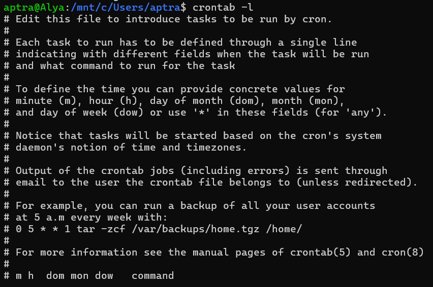
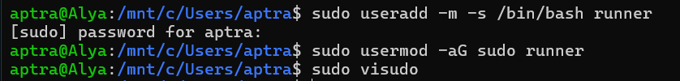
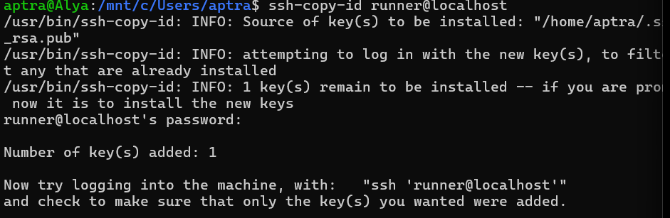
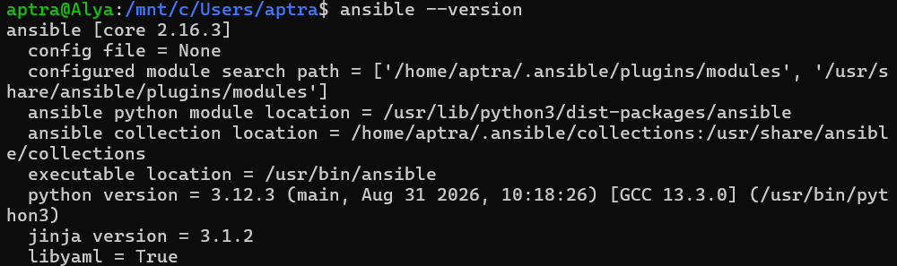
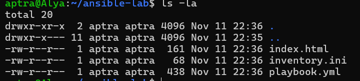
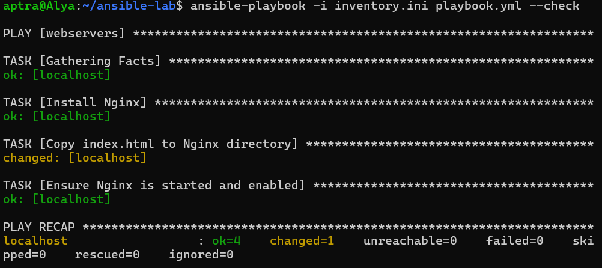
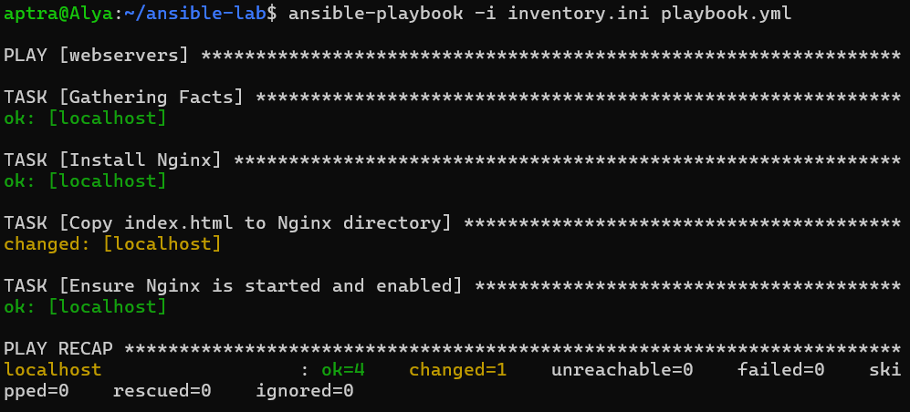
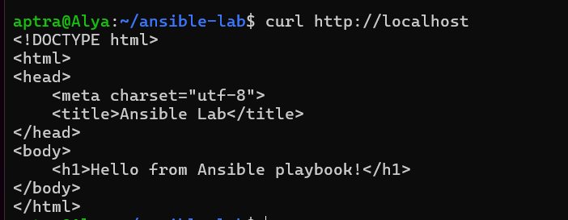

# Лабораторная работа П04: Ansible basics (WSL)

**Выполнила:** Аптракова Альфия, студентка группы ИТ-1-2024 

---

## Что сделано

1. Отключена старая задача `cron` из предыдущей лабораторной работы.
2. В окружении WSL (Ubuntu) создан локальный пользователь `runner` с правами `sudo` без запроса пароля.
3. Сгенерирован SSH-ключ на управляющей машине и настроен безопасный беспарольный доступ по SSH для `runner@localhost`.
4. Установлен пакет `ansible` и проверена его версия.
5. Созданы файлы проекта: инвентарь (`inventory.ini`), тестовая веб-страница (`index.html`) и плейбук автоматизации (`playbook.yml`).
6. Выполнен тестовый прогон плейбука с флагом `--check` (успешно, `failed=0`).
7. Выполнен боевой запуск плейбука (установка Nginx, копирование `index.html`, запуск службы).
8. Проведена успешная проверка работы веб-сервера через утилиту `curl` (`http://localhost`).

---

## Структура проекта

- `playbook.yml` — Ansible-плейбук для развертывания веб-сервера Nginx.
- `inventory.ini` — файл инвентаря для подключения к локальному окружению WSL.
- `index.html` — пользовательская HTML-страница.
- `screenshots/` — директория с графическими доказательствами выполнения этапов лабораторной работы.

---

## Скриншоты выполнения

- **Отключение старого cron:**
  

- **Настройка пользователя runner и прав sudo:**
  

- **Настройка SSH-доступа по ключу:**
  

- **Проверка версии Ansible:**
  

- **Файлы проекта:**
  

- **Тестовый прогон плейбука (--check):**
  

- **Боевой запуск плейбука:**
  

- **Проверка работы веб-сервера через curl:**
  

---

## Вывод

В ходе лабораторной работы были освоены базовые принципы работы с системой управления конфигурациями Ansible в среде WSL: создание файлов инвентаря, написание плейбуков с использованием модулей `apt`, `copy` и `service`, а также проведение тестовых и боевых запусков для автоматизированного развертывания веб-сервера Nginx.
